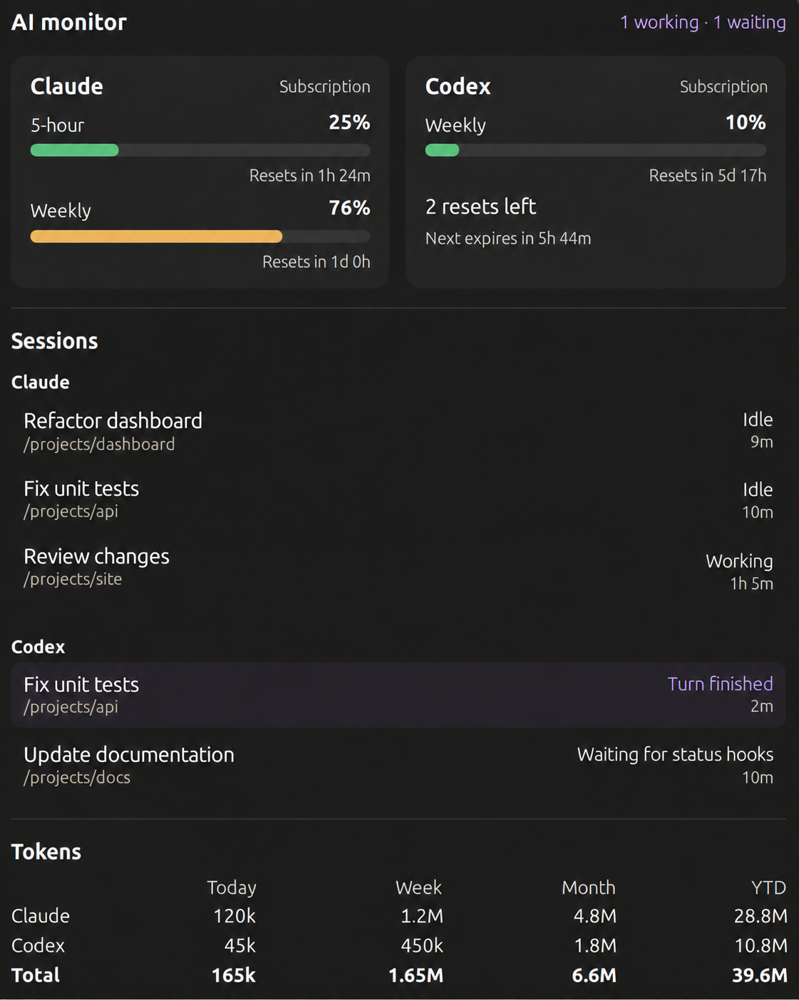
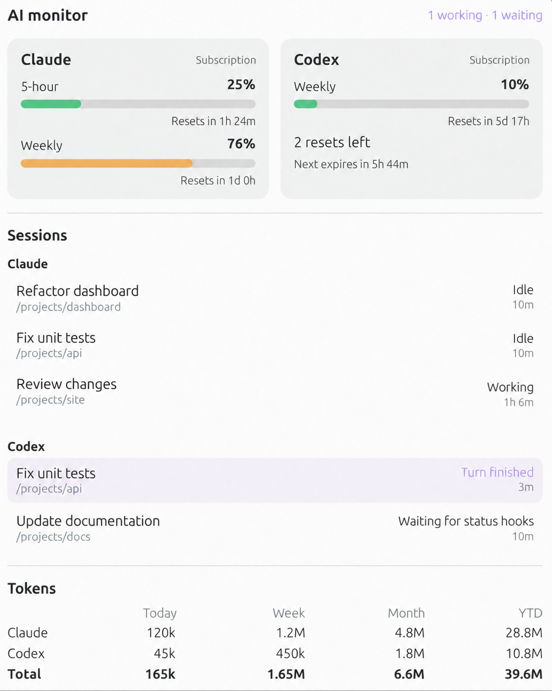
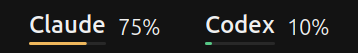
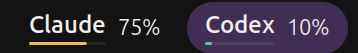

# ai-monitor

**v1.0.0** · [Release notes](docs/releases/v1.0.0.md) · [Privacy](PRIVACY.md) · [Security](SECURITY.md)

Keep track of Claude Code and Codex without leaving your desktop. One GNOME panel
menu brings together subscription limits, token usage, terminal sessions, and
optional alerts when an agent needs your input.

ai-monitor is standalone. It uses your existing CLI logins, runs as your desktop
user, and requires no separate account or paid API key.

## Screenshots

Anonymized previews based on dashboard screenshots. Project labels, plans, and
usage figures were edited for privacy and are illustrative. Images are cropped
above the footer; current controls are described below. Click to view full size.

| Dark theme | Light theme |
| --- | --- |
| [](docs/screenshots/dashboard-dark.png) | [](docs/screenshots/dashboard-light.png) |

| Normal panel | An agent needs attention |
| --- | --- |
|  |  |

## Features

- **Subscription windows:** short and weekly allowances, reset countdowns, and
  remaining Codex reset credits when available. Green below 70%, orange near the
  limit, red when exhausted; gray marks unavailable or stale data.
- **Usage totals:** Today, Week, Month, and Year to Date, per tool and combined.
  Cached-token counts and cache-hit percentages can be enabled together in
  Settings; both are hidden by default. Rows highlight on hover.
- **Terminal sessions:** native session names, working-directory paths, and
  explicit working, approval, question, and finished-turn states. Click a session
  to return to its terminal.
- **Subagent activity:** the parent row shows an active count, with messages such
  as “Working · 3 subagents” or “Waiting for 3 subagents to finish.”
- **Optional attention alerts:** a purple panel highlight, desktop banners, and
  sound once, every minute, or every five minutes. Automatic sound defaults to off.
- **Quick actions:** Silent mode, Acknowledge agents, and the settings cog share
  one footer row. Silent mode changes audio only; acknowledgement clears current
  attention and leaves future state changes eligible to alert.

## Compatibility

Primary development environment: **Ubuntu 24.04 LTS, GNOME Shell 46**. The supplied
screenshots demonstrate the interface, but complete desktop acceptance testing has
not been recorded. Automated tests mock GNOME's desktop APIs.

| Setup | Support and limits |
| --- | --- |
| Linux, GNOME Shell 46–50 | Declared extension targets; GNOME 47–50 need desktop validation |
| Xorg or Wayland | Native GNOME panel and window activation; no simulated keystrokes |
| Ubuntu / GNOME Terminal | Exact tab activation, plus active-tab acknowledgement and sound suppression when its D-Bus APIs are available |
| tmux | Exact pane selection through one attached client; detached sessions need attaching first |
| Other local terminals | Window-ID/process matching, with a chooser for ambiguous windows; exact tab selection is not available |
| High-DPI or smaller displays | Theme-aware panel geometry, bounded menu height, narrower layout with stacked quota cards |
| x86-64 / ARM64 | No bundled native executable; system Python/GJS and the installed CLIs must support the architecture. Hardware validation is still needed |
| SSH, containers, remote agents | No remote terminal forwarding |
| KDE, Xfce, macOS, Windows | Not supported |

Requirements: Python 3.11+, GNOME Shell 46–50, GSettings, GTK 4.10+,
libadwaita 1.4+ with Python GI bindings, and a systemd user session. Install a recent
Claude Code and/or Codex CLI with lifecycle hooks. tmux is optional.

Please report compatibility results with the distribution, GNOME version, session
type, terminal, display scale, and CLI versions. See [Contributing](CONTRIBUTING.md).

## Install

Download and extract a source release, or clone this repository. On Ubuntu, install
the desktop prerequisites if missing:

```sh
sudo apt install python3 python3-gi gjs gir1.2-adw-1 libglib2.0-bin
```

From the source directory, in your local GNOME desktop session, **without sudo**:

```sh
./install.sh
```

The installer copies application files, compiles the schema, creates a systemd
user service, and merges ai-monitor's passive hooks into the CLI settings. It
preserves unrelated hooks and preferences. No pip, npm, downloads, or root service
is needed by the installer. Running it again updates the installation.

Then:

1. Log out and back in to load the extension. On Xorg, Alt+F2 → `restart` → Enter
   also reloads GNOME Shell. Updated JavaScript modules need a Shell reload.
2. Restart Claude/Codex so they load the hooks. In Codex, open **`/hooks`** and
   review/trust the ai-monitor handlers; untrusted hooks will not run.
3. If extensions are globally disabled, enable them in the Extensions app.

For optional audio playback:

```sh
sudo apt install gstreamer1.0-plugins-base-apps
```

Open the cog → **Sound** to enable audio, choose an effect or custom local file,
adjust volume, and set the repeat interval. The first effect, **Message**, is the
default. Previews are explicit and playback is capped at 15 seconds.

Optional installer flags:

```sh
./install.sh --dry-run     # Validate and show destinations
./install.sh --no-hooks    # Install without changing CLI settings
```

Put `~/.local/bin` in your PATH to use the `ai-monitor` command directly.

## Sessions and alerts

Launch the CLIs normally. Native names are matched by exact session ID rather
than guessed from another session in the same project. You can supply a label:

```sh
ai-monitor run --name "Fix checkout" claude
ai-monitor run --name "Review tests" codex
```

Silent processes are not guessed to be idle. Without usable hooks, the session
remains visible as **Waiting for status hooks**. Codex events from a background
server are linked only when the terminal can be identified unambiguously.

Codex permission hooks run before the approval decision, so they do not always
mean the terminal is waiting for a person. Automatically reviewed requests remain
**Working** when exact-turn review metadata is available. Genuine or unknown
permission requests and blocking user questions must persist for at least three
seconds before alerting; resumed work cancels them. Internal/async question
helpers do not count as blocked user input. Missing review metadata falls back
to the confirmation delay rather than suppressing possible manual prompts.

Subagents stay inside the parent session row, without adding terminal rows. Counts
depend on delivered start/stop hooks: missed events can leave a count incomplete
or stale. Claude's optional background-task snapshot helps reconcile it. A
session restart or interruption clears tracking. Waiting for subagents counts as
work; real user questions and approvals take priority.

Sound is suppressed in the identified focused GNOME Terminal tab or active tmux
pane, and while the desktop is locked. Other waiting terminals can still alert.
A waiting session shown in the identified focused GNOME Terminal tab counts as
seen and is acknowledged, which also stops the panel highlight. Other terminal
applications depend on an inherited X11 window ID, which cannot tell tabs apart:
sound is suppressed there, but the session is not acknowledged. If identity
cannot be resolved, sound remains eligible. Suppression never replays a
once-only alert later; repeated reminders resume after their selected interval.
Desktop banners follow GNOME's notification controls.

## Usage and privacy

Token history comes from available local CLI records. Weeks begin Monday; all
calendar periods use local time. Totals include input, cached input, cache writes,
and output once. “Cache hit” means cached-read input divided by all input, weighted
across tools. Hiding cache details does not change totals.

Subscription limits are account-wide and can include other devices. They are
queried using the existing CLI login at most every ten minutes while the desktop
is unlocked, with backoff and stale-data labels. Claude's usage endpoint is an
unofficial integration and can change. ai-monitor never refreshes Claude's login.
Codex reads account limits through its installed `app-server` interface.

The service stores numeric summaries and terminal/session metadata locally. It
does not send prompts, source code, session names, or working-directory paths to
an ai-monitor server. There is no telemetry. Session names and paths can still be
sensitive: redact status output and screenshots before sharing them.

Older records may be missing. YTD covers available history, not guaranteed full
year coverage. Finished-day archives preserve counts after source cleanup but do
not automatically merge later corrections to those archived days.

See [Privacy](PRIVACY.md) for local storage, network access, and deletion details.

## Uninstall

Even after deleting the source checkout:

```sh
ai-monitor uninstall          # Keep history and preferences
ai-monitor uninstall --purge  # Also remove history and reset preferences
```

Or use `./uninstall.sh` with the same flags from the source directory. Uninstall
removes only ai-monitor's exact hook handlers, service, command, and extension.
Other settings and hooks remain. JSON formatting may be normalized. Damaged CLI
settings stop uninstall before application removal so the JSON can be repaired.

Paths honor `XDG_DATA_HOME`, `XDG_CONFIG_HOME`, and `XDG_STATE_HOME`. Use the same
environment for installation, updates, and uninstall.

| Purpose | Default location |
| --- | --- |
| Application | `~/.local/share/ai-monitor` |
| Extension | `~/.local/share/gnome-shell/extensions/ai-monitor@local` |
| Command | `~/.local/bin/ai-monitor` |
| Service | `~/.config/systemd/user/ai-monitor.service` |
| Local state | `~/.local/state/ai-monitor` |
| Socket | `$XDG_RUNTIME_DIR/ai-monitor/control.sock` |
| Preferences | GSettings `org.gnome.shell.extensions.ai-monitor` |

Claude settings use `$CLAUDE_CONFIG_DIR/settings.json`, defaulting to
`~/.claude/settings.json`. Codex hooks use `$CODEX_HOME/hooks.json`, defaulting to
`~/.codex/hooks.json`.

## Troubleshooting and development

```sh
./status.sh
systemctl --user status ai-monitor.service
journalctl --user -u ai-monitor.service -n 50
ai-monitor status
ai-monitor refresh
ai-monitor ack
make check
make dist
```

Development tests additionally require Node.js 18+. They use isolated fixtures
and mock external services; they do not play audio or read personal conversations.
A real Unix-socket test skips when the environment prohibits sockets. The test
suite does not replace [desktop acceptance checks](docs/desktop-check.md).

`make dist` creates `dist/ai-monitor-1.0.0-source.zip` and a SHA-256 checksum from
an explicit allowlist. For an isolated install/uninstall check without contacting
the desktop or changing real CLI settings:

```sh
./install.sh --destdir /tmp/ai-monitor-stage
./uninstall.sh --destdir /tmp/ai-monitor-stage --purge
```

## License and sound credits

Source code is released under the [MIT license](LICENSE). Thanks to
**SupremeTyLewisS** and **Universfield** for the notification sounds shared on
Pixabay. Those recordings retain the Pixabay Content License; see
[third-party notices](THIRD_PARTY_NOTICES.md) for the sources and terms.
